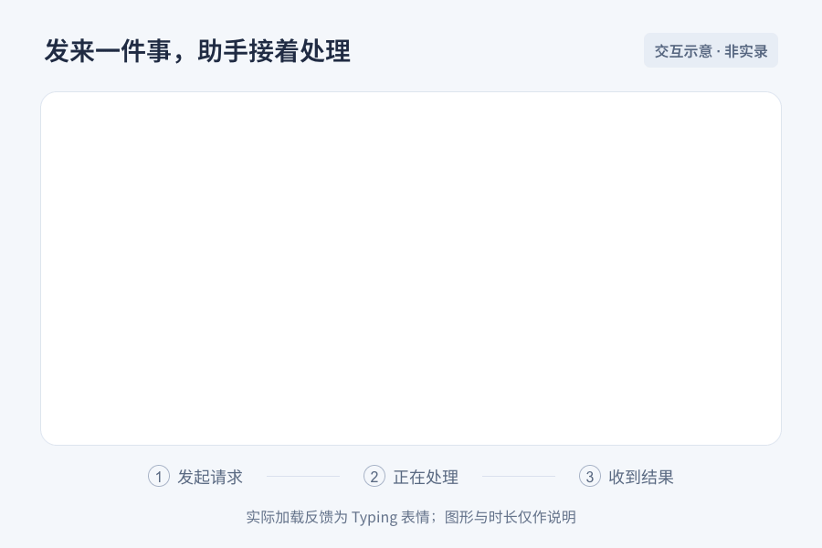
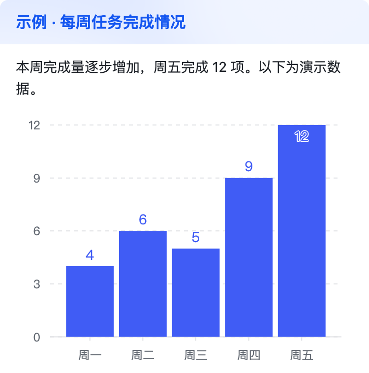
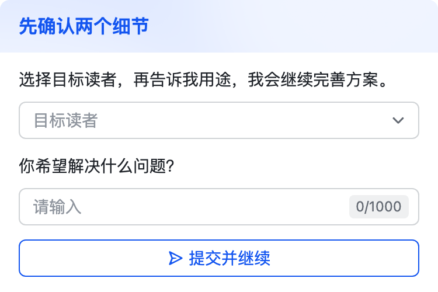
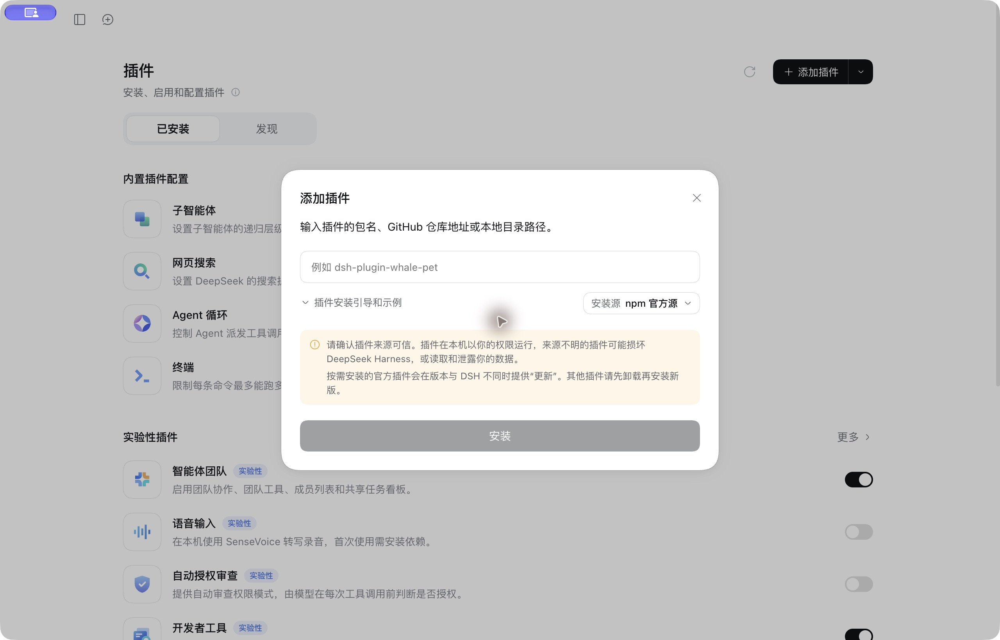
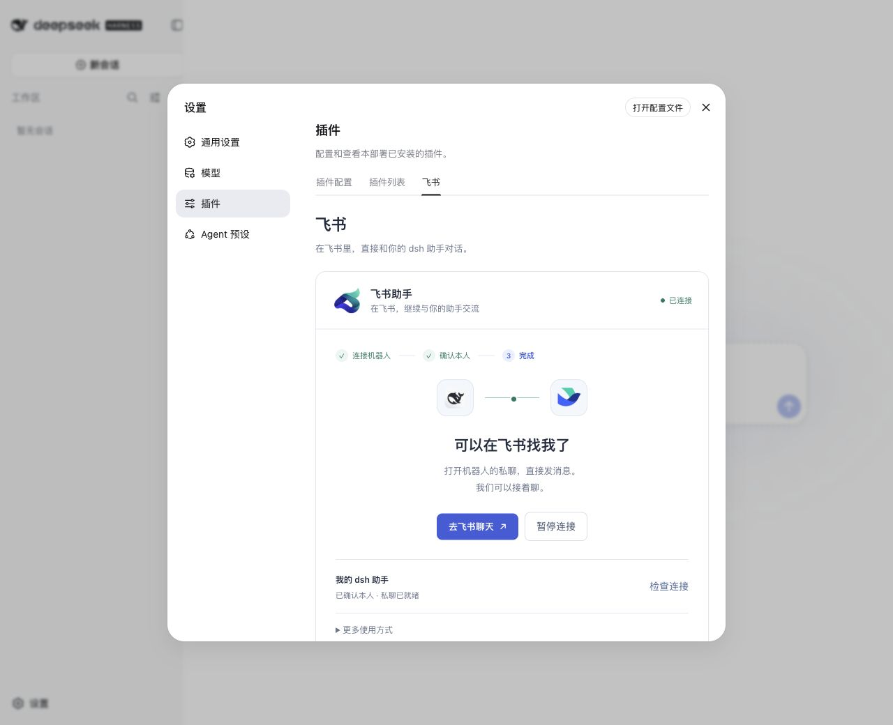

# dsh-larkbot

当前发布版本：**0.1.0**。

**离开电脑，也能在飞书里找到你的 dsh 助手。**

[DeepSeek Harness](https://deepseek.com/harness/) 已经提供桌面应用和 Web 界面。在电脑前，它适合处理复杂工作；到了通勤、会议间隙，或只是想随手交代一句话时，你可能更习惯打开手机飞书。

dsh-larkbot 给正在运行的 Harness 增加一个飞书入口：私聊交代需求、讨论方案、继续之前的飞书话题。会话和获准保存的偏好留在宿主机器上，重启后可以恢复。日常直接交流，记忆在后台工作。

飞书有自己的通道会话，**不会自动接管桌面或 Web 中已有的聊天**。默认使用当前宿主的模型，只开放本人私聊、内置记忆和结构化展示能力；访问文件、运行命令等工具需要另外授权。

[看交互效果](#用起来是什么样) · [连接飞书](#连接飞书) · [隐私规则](#隐私和运行边界) · [开发者部署](#开发者与团队部署) · [排障](#备份升级与排障)

## 用起来是什么样

发出请求后看到处理反馈，完成后收到分段回复。简单问题直接用文字回答，需要结构时使用富文本或可展开卡片。



*交互示意，非飞书实录；文案与等待时间用于说明行为。新建连接默认申请处理中反馈与卡片交互所需能力；手动部署的开关见下方高级说明。*

[静态图](assets/readme/reply-demo.png) · [观看 MP4](assets/readme/reply-demo.mp4)

| 你想做什么 | 怎么使用 |
| --- | --- |
| 交代一个需求 | 直接发消息，不必记命令 |
| 让助手了解你的偏好 | 在私聊说“以后先给结论，再展开”；保存后自然确认 |
| 继续之前的飞书话题 | 当前聊天自动恢复；`/sessions` 可选择该聊天里的旧对话 |
| 换话题或停止处理 | `/new` 开始新对话；`/stop` 取消当前处理及排队消息 |
| 调整模型或思考深度 | `/model`、`/thinking` 查看并选择当前宿主提供的选项；已配置底部菜单时也可点击「设置」 |
| 在群里协作 | 管理员明确配置用户与群准入后，通过 @ 菜单选中机器人提问 |

### 图表、表单和可打开的作品

直接说“用柱状图比较这些数据”“先让我选择两个选项”“把方案画成架构图”即可。助手可按内容调用内置展示工具：图表在卡片里查看，表单提交后继续原话题；需要完整阅读和放大的报告、图示可生成飞书文档与画板。

**一次生成，两端展示。** 支持原生作品接口的 Harness（当前 App `0.2.1-rc.2`）会在同一会话里显示本地作品卡，点击可预览图表、图示和报告；飞书适配器使用同一份数据生成卡片或云端作品。本地预览是插件生成的静态 HTML 快照，支持展开数据，表单仍在飞书提交。旧版 Web `0.1.1-rc.2` 没有这个原生作品接口，保留现有对话和飞书展示能力。

 

*由插件实际渲染器生成的手机宽度预览，使用演示数据；不是飞书客户端实录。表单预览中的按钮不用于真实提交。*

文档与画板是默认能力：**新建机器人时，首次扫码一并申请所需权限**，连接后直接使用。旧版或手动创建的机器人若缺少权限，设置页会显示「补充默认权限」，扫描一次即可更新原应用，无需重新创建、配对或填写 Secret，聊天连接继续保持。企业要求审批时，批准后再重新检查。后台部署可按 [文档与画板权限清单](src/rich-scopes.ts) 开通同等应用身份权限并发布。

| 内容 | 交付方式 | 边界 |
| --- | --- | --- |
| 柱状图、折线图、饼图 | 飞书原生图表卡片 | 基于已提供的数据；示例数据明确标注 |
| 普通输入与单选 | 签名绑定的表单卡片 | 仅原用户、原聊天、原话题可提交，一份表单只处理一次 |
| 流程、架构图 | 私有文档内画板；可用时附预览 | 最多 16 个节点；更复杂的图建议拆分 |
| 分章节报告 | 私有飞书文档 | 创建前检查权限，完成后只给本人阅读权限 |
| HTML / JavaScript 源码 | 文字或代码说明 | 当前版本不执行网页脚本，也不提供公网交互页面 |

`/results` 找回当前话题的作品；作品随会话保存，重启仍可查看。修改作品保留旧版；云端生成新版本，不覆盖用户手动编辑的文档。缺少云文档权限时先保留本地内容，补充授权后可点原卡片继续。完整内容也可用 `/result <ID>` 查看。

云端作品当前仅支持本人私聊。群里的图表和表单继续使用该群获准的上下文；图示与报告保留聊天内文字，不自动创建群共享文件。文档创建结果不确定时不会自动重建；已保存文档 ID 时会核对权限和内容，仅续用空文档或与已保存作品完全一致的内容，不覆盖手动编辑。

## 连接飞书

先在 Harness 中选好默认模型，确认可以正常对话。接入通过 **设置 → 插件 → 飞书** 完成，无需手动填写团队 JSON 或整理用户 ID。

### 准备一次

- **安装本插件：** PC App 可按下方图文步骤操作；当前使用本仓库构建的 tgz 安装，[构建方法见下文](#开发者与团队部署)。
- **安装官方 Lark CLI：** 它负责专用 profile 和消息长连接，需要在宿主机器上可用。安装后即可由接入界面创建与配置机器人。

```bash
pnpm dlx @larksuite/cli@1.0.98 install
lark-cli --version
```

宿主会搜索 PATH 和常见安装目录；若界面仍提示找不到 CLI，在插件配置的 `executable` 中填写其绝对路径。Web 运行在另一台机器时，CLI 也安装在那台机器上。

### PC App：通过「添加插件」安装

侧栏 **插件 → 添加插件** 就是安装入口，安装后再进入飞书连接设置。



[观看 12 秒入口回放（MP4）](assets/readme/desktop-install-steps.mp4) · [查看插件管理页](assets/readme/desktop-install-01.jpg) · [查看安装引导](assets/readme/desktop-install-03.jpg)

*App `0.2.1-rc.2` 实机截图组成的关键帧回放，非连续录屏；本段只展示入口与安装引导，未执行安装。*

1. 在仓库运行 `pnpm pack`，取得它输出的 `.tgz` 安装包。
2. 打开 PC App 侧栏的 **插件**，点击右上角 **添加插件**，填入安装包的**实际绝对路径**，例如 `/absolute/path/to/dsh-larkbot-0.1.0.tgz`（替换为你的文件）。当前尚未发布 npm 包，这里使用本地路径。
3. 点击 **安装**，检查显示的包名和版本。完成后点击 **立即启用**；需要重启时按 App 提示操作。已安装版本的升级见[备份、升级与排障](#备份升级与排障)。
4. 在 **设置 → 内置插件 → 飞书** 中继续扫码连接；旧版 Web 的入口为 **设置 → 插件 → 飞书**。

### 扫码，然后到私聊打个招呼

1. 打开 **设置 → 插件 → 飞书**，点击「扫码创建并连接」。已有专用机器人可选择「我已有机器人」。
2. 用自己的飞书账号扫描官方授权二维码，确认创建应用及消息、卡片、文档与画板权限。插件会保存独立 profile，配置长连接，并检查发布状态。
3. 若企业要求管理员批准，按界面提示完成审批，回来点击「重新检查」。二维码过期可以刷新。
4. 打开界面提供的机器人私聊，发送本次配对词。插件从真实消息确认发送者；需要二次确认时，在界面选择「这是我，完成连接」。
5. 插件验证宿主模型与存储、启动长连接，并在飞书回复连接确认。**确认回复发送成功后才保存启用状态**；随后发一条普通消息，确认收到实际助手回复。

个人接入默认仅允许配对的本人私聊，`allowedTools: []`；内置记忆与展示工具按身份和聊天范围单独授权。Secret 由后端保存到专用 CLI profile，不出现在连接界面或团队配置里。复用已有机器人时，界面检查现有权限和发布状态，只启用已经授权且检查通过的卡片与处理反馈能力；不会自动扩大应用权限。所缺设置按提示在飞书后台完成。

想把常用操作放到输入框上方，可以让管理员按[底部菜单接入步骤](#可选私聊底部菜单)配置一次「新话题」「历史对话」「设置」。扫码创建已包含菜单事件订阅；菜单样式和条目仍需在飞书后台保存并发布。已有连接完成发布后，先暂停再恢复，插件会重新检查菜单是否可用。

<details>
<summary>查看实际 Web 连接界面</summary>



*实际 Harness Web 设置页面：完成本人私聊配对与确认回复后，卡片显示「已连接」。此图为 Web 界面截图。*

</details>

### 连接后怎么使用

- 保持宿主运行并联网。关闭 App、停止 Web 宿主或电脑休眠后，飞书连接无法继续服务；这个入口不提供远程桌面或远程唤醒。
- 在卡片中「暂停连接」或「恢复连接」。已经启用的连接会在同一宿主重新启动后尝试恢复；关闭浏览器设置页面本身不会停止 Web 宿主。
- 「断开连接」解除当前绑定，保留本地资料和 CLI profile；它不等于删除记忆或会话。
- 同一个机器人在同一操作系统用户下只允许一个接收实例。切换到另一宿主或后台部署前，先停止原连接。

## 开发者与团队部署

开发环境统一使用 **pnpm 11.22.0 + Vitest 4**。先按 [pnpm 安装说明](https://pnpm.io/installation)准备对应版本；仓库的 `packageManager` 和 `pnpm-lock.yaml` 固定工具与依赖版本。

从源码生成包含宿主模块和设置界面的安装包，在仓库根目录运行：

```bash
pnpm install --frozen-lockfile
pnpm typecheck
pnpm test
pnpm pack
```

`pnpm pack` 会通过 `prepack` 构建后端与 `dist/client.cjs`；安装它最后打印的 tgz 文件。源码目录也可用于开发安装，但须先 `pnpm build`，更新后按升级流程重启。链接目录的构建会影响正在使用它的宿主，见[升级说明](#备份升级与排障)。

运行时契约验证覆盖 **CLI / Web `0.1.1-rc.2` 和官方 App 所用的 `0.2.1-rc.2`**；精确 peer 依赖见 [package.json](package.json)。这是原生接口兼容范围，不代表所有平台与企业租户均已完成实机认证。

多人团队、群聊、额外工具权限或独立常驻进程使用下面的手动部署流程。`configFile` / `DSH_LARK_CONFIG` 有值时进入配置文件模式；留空时提供 Web / App 连接界面，两种入口共享消息与安全实现。

<details>
<summary>高级：完整 CLI / 后台部署指南（应用、模型、人员配置、启动与验收）</summary>

### 手动部署准备

以下用于常驻后台、多用户准入、群聊或额外工具授权，以 **源码 checkout + macOS / Linux shell** 为例。先暂停使用同一机器人的 Web / App 连接，再在仓库根目录操作。

| 依赖 | 当前接入基线 |
| --- | --- |
| Node.js | 建议 ≥ 22.20；插件要求 ≥ 22.12 |
| dsh / pnpm | 本节使用 `0.1.1-rc.2` / `11.22.0`；核心依赖见 [package.json](package.json) |
| Lark CLI | `1.0.98`，支持消息和卡片长连接事件 |
| 飞书与模型 | 可创建企业自建机器人的账号；dsh 可用的模型凭据 |

```bash
pnpm add --global @deepseek-ai/dsh@0.1.1-rc.2
pnpm dlx @larksuite/cli@1.0.98 install
dsh --version
lark-cli --version
pnpm --version
```

接入分四步：**创建机器人 → 配置人员 → 配置模型并安装 → 启动验收**。文中这三个名称各有用途：

| 名称 | 保存什么 |
| --- | --- |
| Lark CLI profile：`dsh-team-bot` | 专用飞书应用身份 |
| dsh profile：`feishu-team` | 机器人所加载的插件 |
| `DSH_HOME`：`.runtime/dsh` | 专用模型设置、凭据与原生会话 |

为机器人使用独立 home 和专用 profile，不复用管理员的个人 Agent 配置。后续配模型、安装和启动都使用同一个 `DSH_HOME`。

### 1. 创建飞书应用和专用 profile

先运行 `lark-cli profile list`。已有专用机器人就复用其名称；新建时用一个**尚未存在的名称**执行官方扫码配置：

```bash
lark-cli config init --new --name dsh-team-bot
```

按终端链接在飞书中确认，CLI 自动保存凭据。保留 `--name`：省略名称或复用同名可能覆盖已有配置。该版本使用固定注册模板，授权页可能包含额外权限，需要逐项核对。

在[飞书开发者后台](https://open.feishu.cn/app)确认机器人能力、可用人员及以下权限；前三项用于文字收发，卡片按钮另有要求：

| 权限 | 用途 |
| --- | --- |
| `im:message.p2p_msg:readonly` | 接收私聊 |
| `im:message.group_at_msg:readonly` | 接收群内 @ |
| `im:message:send_as_bot` | 以机器人身份回复 |
| `im:message:readonly`（卡片交互） | `cardInteractions: true` 时，官方 CLI 消费 `card.action.trigger` 所需 |

「事件与回调」选择**长连接**，订阅 `im.message.receive_v1`，完成上述配置后保存并发布应用。无需公网 Webhook 或个人 OAuth；群聊使用前先把机器人加入群。

```bash
lark-cli --profile dsh-team-bot whoami --as bot
lark-cli --profile dsh-team-bot auth status --json --verify
```

记录 `identities.bot.openId`（`ou_…`），作为下一步的 `botOpenId`。它与应用的 `cli_…` App ID 不同。Secret 只交给 CLI 管理，不写入团队 JSON、源码或聊天。

首次接入还需要**你自己的用户 ID**；展开下方步骤，从一条测试消息中取得 `sender_id` 后再继续。

<details>
<summary>首次接入：获取用户 / 群 ID；手动创建与订阅顺序</summary>

需要自行控制最小权限时，在开发者后台手动创建企业自建应用，然后执行 `lark-cli config init --name dsh-team-bot` 交互录入凭据。仍需核对能力、订阅、可用人员和发布状态。

临时监听一条消息，采集准入所需 ID：

```bash
lark-cli --profile dsh-team-bot event consume im.message.receive_v1 \
  --as bot --max-events 1 --timeout 2m
```

让测试用户私聊，或在测试群通过 @ 菜单选中机器人后发消息。事件的 `sender_id` 是用户 ID，`chat_id` 是聊天 ID，`mentions[].id` 可核对机器人 ID。结束临时监听后再启动正式实例；事件正文留在本地，不进入 Git。

如果后台要求先建立长连接，先运行上述监听，再保存订阅并发布应用。

</details>

### 2. 配置运行目录和人员准入

```bash
umask 077
mkdir -p .runtime/workspaces/alice
cp team.config.example.json .runtime/team.config.json
export DSH_HOME="$PWD/.runtime/dsh"
export DSH_LARK_CONFIG="$PWD/.runtime/team.config.json"
export DSH_TELEMETRY_DISABLED=1
```

编辑 `.runtime/team.config.json`，删除不接入的示例用户，替换占位值：

```json
{
  "profile": "dsh-team-bot",
  "botOpenId": "ou_REPLACE_WITH_BOT_OPEN_ID",
  "stateDir": ".state",
  "users": [
    {
      "openId": "ou_REPLACE_WITH_USER_OPEN_ID",
      "direct": true,
      "groupChats": [],
      "cwd": "/absolute/path/to/dsh-larkbot/.runtime/workspaces/alice",
      "allowedTools": []
    }
  ]
}
```

- **先开私聊：** `direct: true`；需开放群聊时，在该用户的 `groupChats` 中加入 `oc_…` 群 ID。同群每个人都要单独授权，消息必须真正 @ 本机器人。
- **路径归属：** `cwd` 填该用户工作目录的绝对路径；`stateDir` 相对团队 JSON 解析，本例落在 `.runtime/.state/`。
- **工具权限：** 首次保持 `allowedTools: []`，内置记忆工具会自动注册。额外工具必须自行校验调用者和资源权限，再按精确名称加入。

<details>
<summary>可选模型、回复形式、超时与容量设置</summary>

完整示例见 [team.config.example.json](team.config.example.json)，校验规则见 [src/config.ts](src/config.ts)。`users` 是显式名单；`direct` 默认关闭，`groupChats` 默认空。

| 配置 | 默认值及作用 |
| --- | --- |
| `provider` / `model` | 不填时使用 dsh 保存的默认模型；填写时选择已配置的路由 |
| `executable` | `lark-cli`，可改为绝对路径 |
| `responseMode` | `auto`；`text` 用于纯文字兼容性排查 |
| `cardInteractions` / `loadingReaction` | 均为 `false`；启用条件见下文 |
| `botMenu` | `false`；手动部署在菜单事件发布并预检通过后设为 `true`，启用独立菜单接收连接 |
| `turnTimeoutMs` / `idleTimeoutMs` | 120 秒处理超时 / 30 分钟闲置释放 Agent |
| `maxSessions` / `maxSessionsPerUser` | 总内存会话 100 个 / 每用户 10 个 |
| `maxPending` / `maxPendingPerSession` | 总排队 100 条 / 每会话 5 条 |
| `maxInputChars` / `maxOutputChars` / `chunkBytes` | 输入 16000 字符 / 输出 32000 字符 / 文字每片 4000 UTF-8 字节 |

</details>

### 3. 配置模型并安装插件

先构建，再在**同一个专用 home** 中配置模型：

```bash
pnpm install --frozen-lockfile
pnpm typecheck
pnpm test
pnpm build
dsh web
```

在本机页面的模型设置中填写提供商、凭据与默认模型，确认能正常对话，然后 Ctrl+C 停止网页进程。继续安装机器人插件：

```bash
dsh plugin --profile feishu-team add "$PWD"
dsh --profile feishu-team --dump-config > .runtime/composed.yml
```

检查配置转储包含 `im-larkbot`、`agent`、`tools`、`session-persistence-jsonl`。该版本的自定义 profile 默认包含 `@deepseek-ai/dsh-base`，无需重复插入；转储可能含敏感信息，只留在忽略目录。

<details>
<summary>自定义宿主配置，或改用 tgz 安装</summary>

插件依赖宿主的 `agents`、`tools`、`sessions`、`sessionPersistence` 服务。修改过基础 profile 时必须保留 JSONL 持久化后端；安装本包开发依赖不能替代宿主配置。

自定义配置写入 `$DSH_HOME/profiles/feishu-team/cordis.patch.yml`，不要编辑启动时重建的 `cordis.yml`。

需要部署构建包时执行 `pnpm pack`，使用实际生成的文件名安装：

```bash
dsh plugin --profile feishu-team add /absolute/path/to/dsh-larkbot-VERSION.tgz
```

tgz 不含仓库的 `scripts/`，使用下文的通用启动命令。源码安装链接本地目录，更新后需构建再重启。

</details>

### 4. 启动与首次验收

保持上述环境变量，前台启动：

```bash
dsh --profile feishu-team
```

源码 checkout 也可运行 `bash scripts/start-bot.sh`。日志出现 `[im-larkbot] ready` 后，依次验收：

| 检查 | 预期结果 |
| --- | --- |
| 白名单用户私聊 | 收到实际模型回复 |
| 获准群内真正 @ 机器人 | 正常回复；未 @、未知用户、未获准群不触发 |
| 私聊保存非敏感偏好，停止并重启后追问 | 已保存的会话与偏好可恢复；未授权的偏好不会带入群聊 |
| 换第二名真实用户尝试查询、恢复或删除第一人的资料 | 不允许跨用户访问；模拟测试不能代替这一步 |

`ready` 只表示事件连接就绪，不能替代模型回复验收。Ctrl+C / SIGTERM 会等待会话保存与关闭；同一状态目录只运行一个实例。

#### 可选：卡片按钮与处理中反馈

| 想开启的体验 | 飞书后台 | 团队配置与验收 |
| --- | --- | --- |
| 选择旧对话的按钮 | 额外授予 `im:message:readonly`，配置长连接回调 `card.action.trigger`，保存并发布 | `cardInteractions: true`，重启后确认 `cards ready`，实际点击 `/sessions` 按钮 |
| 原消息下的处理中状态 | `im:message.reactions:write_only` 或覆盖表情操作的权限 | `loadingReaction: true`，观察 `Typing` 出现及结束后清理 |

扫码新建连接会在开启卡片交互时申请上述额外权限。已有应用需补充授权并发布；只有基础三项消息权限时，文字回复可以正常工作，但按钮回调可能无法消费。可先运行只做预检的命令，再实际点击按钮验收：

```bash
lark-cli --profile dsh-team-bot event consume card.action.trigger --as bot --dry-run
```

静态富文本和长回答卡片不依赖按钮开关；没有历史时 `/sessions` 返回文字。处理中反馈是表情而非流式回复，网络故障或崩溃可能留下表情。消息、已启用的卡片回调和菜单事件分别使用独立消费者；运行期间不要额外启动相同事件的调试消费者。

**按钮验收：** 先发送一句普通消息建立会话，再发送 `/sessions`，点击新卡片中的「换个话题」并在确认框中确认，应收到开始新话题的回复。`/help` 和 `/status` 使用普通文字，不作为按钮验收入口；切换宿主或已使用过修改操作时，请重新发送 `/sessions` 获取新卡片。

**加载反馈：** 私聊中的模型、思考深度和话题操作在收到并校验后，若处理超过约 200 毫秒，先显示加载卡片，数据就绪后在同一条消息中替换为结果；很快完成时直接显示结果。加载和最终卡片均声明 `config.update_multi: true`；更新使用现有 `im:message:send_as_bot` 权限，无需额外申请消息更新权限。[官方卡片更新接口](https://open.feishu.cn/document/uAjLw4CM/ukTMukTMukTM/reference/im-v1/message/patch)

模型目录成功读取后短时缓存 30 秒，并合并同时发生的读取；模型切换仍会实时校验可用性。缓存只减少重复读取，不会把尚未保存的选择显示为成功。普通对话及群聊继续使用已启用的“正在输入”反馈。

当前官方 CLI 没有自定义同步回调 Toast 的接口，交互进度显示在卡片内。卡片点击事件在交给插件前还会读取一次原卡内容，所以网络延迟也会影响加载反馈出现的时间；数据尚未准备好时，不会提前显示操作成功。

#### 可选：私聊底部菜单

飞书自建机器人可以在输入框上方显示常驻的**悬浮菜单**，不需要另建飞书智能体。菜单只支持机器人私聊，飞书客户端需要 **7.22 或更新版本**；群聊继续使用 @ 和命令。[飞书官方菜单说明](https://open.feishu.cn/document/uAjLw4CM/ukTMukTMukTM/bot-v3/bot-customized-menu)

在开发者后台打开当前应用，完成以下配置：

1. 在 **应用能力 → 机器人 → 机器人自定义菜单** 开启菜单，选择悬浮菜单样式。
2. 按下表建立三个主菜单。「设置」添加两个子菜单；四个可点击入口的响应动作均选 **推送事件**，事件标识逐字填写。
3. 在 **事件与回调 → 事件配置** 使用长连接，保留消息事件，并订阅 **机器人自定义菜单事件** `application.bot.menu_v6`。
4. 保存菜单和事件配置，创建应用版本并发布；需要审批的租户须等待批准。客户端菜单可能在发布成功约 5 分钟后才更新。

| 菜单位置 | 显示名称 | 事件标识 | 打开什么 |
| --- | --- | --- | --- |
| 主菜单 | 新话题 | `dsh.new` | 归档当前对话，下一条消息开启新话题 |
| 主菜单 | 历史对话 | `dsh.sessions` | 本人在当前私聊中的历史对话 |
| 主菜单 | 设置 | 仅包含子菜单 | 模型与思考深度入口 |
| 设置的子菜单 | 模型 | `dsh.model` | 当前宿主已配置的模型 |
| 设置的子菜单 | 思考深度 | `dsh.thinking` | 当前模型支持的思考档位 |

订阅菜单事件本身不要求额外权限；回复复用 `im:message:send_as_bot`。要点击回复卡片里的模型、档位或历史会话按钮，还需启用上节的卡片回调能力。[菜单事件官方说明](https://open.feishu.cn/document/client-docs/bot-v3/events/menu)

用专用 profile 做只读预检：

```bash
lark-cli --profile dsh-team-bot event consume application.bot.menu_v6 --as bot --dry-run
```

预检须返回 bot 身份，且凭据、事件已发布和权限三个检查项均通过。**Web / App 接入**会在恢复连接时执行此检查，只有证据完整才启用菜单接收；旧应用未配置菜单仍可正常聊天。**手动配置文件部署**的 `botMenu` 默认 `false`，预检通过后改为 `true` 并重启，确认日志出现 `menu ready`。需要交互卡片时同时开启 `cardInteractions`，等待 `cards ready`。

扫码配对会保存经过验证的本人私聊地址。手动部署的用户先给机器人发一句普通消息，再点击「历史对话」或「设置 → 模型」完成验收。菜单事件只使用飞书提供的操作者身份；回复发回该人的私聊，事件里的任意聊天 ID 或显示名不能改变身份或访问范围。

没有 `application:application:patch` 权限时，直接按上面的控制台步骤配置即可；插件不会为了菜单额外申请应用管理权限。需要自动化管理且已具备该权限时，可用 [src/bot-menu.ts](src/bot-menu.ts) 的 `buildBotMenuPlan(appId)` 生成待审核的能力和订阅请求。它只生成配置，执行请求和发布仍由管理员完成。

<details>
<summary>macOS 后台运行与日志</summary>

源码 checkout 提供当前登录会话内的 launchd 包装：

```bash
scripts/manage-service.sh start
scripts/manage-service.sh status
scripts/manage-service.sh stop
```

它固定使用仓库的 `.runtime/dsh`、`.runtime/team.config.json` 和 `feishu-team`，不会沿用 shell 中的自定义路径或模型凭据环境变量。模型凭据应保存在专用 home 中，日志位于 `.runtime/logs/`。

脚本不配置登录自启或崩溃自动重启，注销或重启电脑后需要重新 `start`。Linux 可用进程管理器执行通用启动命令，保留相同环境与优雅停止流程。

`start-bot.sh` 则允许通过 `DSH_HOME`、`DSH_LARK_CONFIG` 覆盖默认路径。

</details>


</details>

## 用户使用与高级操作

日常直接交流，`/help` 查看简短指引，`/status` 确认可继续聊天。记忆在后台工作，不需要用户维护条目列表。

已启用菜单时，私聊可直接点「新话题」「历史对话」「设置」。模型和思考深度按**本人、当前聊天 / 话题**保存，重启后继续使用；选择只影响后续回复，不修改宿主的全局默认模型。可选项来自当前宿主的模型配置，不支持调整思考深度的模型会明确提示。

App 同时打开某个飞书私聊时，可能占有该原生会话的写入权。现代宿主遇到这种明确占用，会让飞书从已保存历史建立独立续聊：保留飞书话题名称和选择，App 中的原会话不受影响，之后两边独立发展。续聊仍使用飞书的权限和记忆范围。群聊不会自动复制被客户端占用的历史，需先关闭客户端中对应会话再重试。

<details>
<summary>排障、命名会话与主动管理记忆的命令</summary>

| 命令 | 用途 |
| --- | --- |
| `/help advanced` | 完整说明 |
| `/status detail`、`/sessions detail` | 当前获准范围的诊断与会话 ID |
| `/model`、`/thinking` | 查看当前模型、思考深度及可选项；卡片交互可用时直接点击选择 |
| `/resume <ID>`、`/rename <标题>` | 恢复当前聊天的旧会话、命名当前会话 |
| `/remember <内容>` | 私聊保存私密个人资料；群内显式保存当前聊天资料 |
| `/remember --chat <内容>` | 仅当前聊天 / 话题使用 |
| `/memory [global\|chat]`、`/memory search <关键词>`、`/memory show <ID>` | 查询本人在当前渠道可读的条目 |
| `/memory share <ID>`、`/memory unshare <ID>` | 仅本人私聊，逐条授权或撤销群聊使用 |
| `/forget <ID>` | 删除可管理的长期记忆，不擦除历史与日志 |
| `/whoami` | 查看接入层识别的用户与聊天身份 |

</details>

## 隐私和运行边界

个人记忆先按权限过滤，再交给模型；说“我是管理员”或换一个显示名不会改变身份。

| 谁在什么地方提问 | 可使用的资料 | 对话历史 |
| --- | --- | --- |
| 本人私聊 | 本人的个人记忆 + 当前聊天记忆 | 仅当前聊天 / 话题 |
| 本人获准的群聊 | 本人明确共享的个人条目 + 当前群 / 话题记忆 | 仅该用户在当前群 / 话题的历史 |
| 其他用户 | 无权读取、恢复或删除你的资料 | 与你的会话隔离 |

共享由本人在私聊逐条授权，之后可用于**本人所有获准群会话**；群回复对所有成员可见。群模型不会自动写入长期记忆，本人仍可显式发 `/remember`。撤销或删除共享会隔离旧群上下文并阻止旧授权下尚未发送的回复，已发出的消息无法收回。

**工具权限有独立边界：** `cwd`、profile 和工具允许列表不是 OS 沙箱。不互信成员需要编程 / 文件工具时，应使用独立 OS 身份或容器执行器，并按用户绑定业务凭据；也不要加载会向 Agent 注入私人上下文的未审核插件。

当前通道不提供个人飞书 OAuth、任意飞书业务操作、附件理解、流式卡片、多副本或定时工作流。消息持久化去重后执行，崩溃可能导致无回复；结果未知的操作不会自动重放，不承诺端到端 exactly-once。

## 备份、升级与排障

升级顺序：**停止 → 备份 → 安装锁定依赖 → 类型检查与测试 → 构建 / 重装包 → 启动验收**。运行中重建链接目录可能触发宿主热加载，不要通过删除状态来升级。

暂停连接或停止服务后，按部署方式备份以下内容：

| 路径 / 归属 | 内容 |
| --- | --- |
| UI 接入：`~/.dsh-larkbot/hosts/<宿主代际>/<home 标识>/` | `connection.json`、每个机器人与用户的通道状态、工作目录；可用插件 `dataDir` 覆盖 |
| CLI 部署：`.runtime/.state/` | `memory.json`、`sessions.json`、`messages.json`、`model-preferences.json`、`direct-chats.json`、`artifacts.json`、启用卡片时的 `card-actions.key` |
| 宿主的原生持久化目录；上文 CLI 示例为 `.runtime/dsh/sessions/` | 原生会话日志，与通道状态一并保留 |
| CLI 部署：`.runtime/team.config.json` | 人员、群、工作目录与运行参数 |
| 宿主模型设置 / 凭据、CLI 专用 profile | 恢复运行所需配置，按私有凭据备份 |

两代宿主的 UI 状态按代际和 home 分目录保存，新接入不会覆盖或自动导入旧后台实例。原生日志仍由各自宿主管理；不要让两代宿主共享同一原生会话目录。机器人身份锁另存于 `~/.dsh-larkbot/leases/`，用于阻止同机跨 home / profile 重复接收，不能用复制锁文件代替恢复实例。

状态目录权限为 0700、文件为 0600，**并非加密**。`/forget` 与 `/new` 不会安全擦除历史、日志或备份。

<details>
<summary>迁移、回滚与常见问题</summary>

迁移时保留应用 / profile、用户、聊天和工作目录归属，不猜测映射，也不把旧群日志整体导入新会话。旧版本没有群公开许可的个人记录默认私密，旧群记忆和上下文保留在磁盘但不会自动导入。升级后的 schema 不交给不支持的旧程序；回滚需在隔离备份上验证。

| 现象 | 检查顺序 |
| --- | --- |
| 没有「飞书」设置页 | 插件是否装入当前宿主，安装包是否包含 `dist/client.cjs`；配置文件模式不提供扫码控制面 |
| 界面提示 CLI 不可用 | 在宿主机器安装 Lark CLI；检查 PATH 或插件 `executable` 的绝对路径 |
| 等待审批 / 权限未生效 | 飞书后台的权限与发布状态；批准后点击「重新检查」 |
| 配对词发送后未连接 | 机器人是否已发布、消息是否发在本人私聊、配对词是否过期；继续按界面确认本人 |
| 没有 `ready` | CLI 是否在服务 PATH、专用 profile 的 bot 认证、长连接订阅、网络 |
| `ready` 但不回复 | 应用发布与可用人员 → 用户 ID、准入配置、真实 @ → 模型凭据 |
| 按钮无响应 | `im:message:readonly` 已授权 → `card.action.trigger` 回调与发布 → CLI dry-run 预检 → `cards ready` → 实际点击 |
| 私聊没有底部菜单 | 客户端 ≥ 7.22 → 自定义菜单开启并选悬浮样式 → 版本已发布 → 等待客户端缓存更新；群聊不显示 |
| 菜单可见但点击无响应 | `application.bot.menu_v6` 已订阅并发布 → 菜单事件标识与上表一致 → 预检通过 → 恢复 UI 连接或开启 `botMenu` 后重启 → `menu ready` |
| 无法创建 / 恢复会话 | 模型路由、JSONL 后端、工作目录匹配、原生日志可读性 |
| 提示另一个实例正在使用 | 先暂停同一机器人的 Web / App 或停止后台实例；确认原进程及 CLI 子进程均退出，仅在确定锁已失效后人工处理，保留去重账本 |
| 发送失败或结果未知 | 查阶段日志，不自动重发；由用户发送新消息，避免重复执行工具 |

</details>

## 开发与仓库约定

工程组织参考 [dsh-context 的 Vitest 分组](https://github.com/bowenliang123/dsh-context/blob/main/vitest.config.ts)：源码测试分开配置运行环境，真实宿主契约单独验证。保留本插件已验证的 TypeScript + esbuild 构建及宿主模块加载方式。

```bash
pnpm install --frozen-lockfile
pnpm check          # 类型检查 + 全部测试与覆盖率
pnpm build          # 宿主模块 + Web / App 客户端
pnpm --config.ignore-scripts=true pack --dry-run --json
```

| 开发任务 | 命令 |
| --- | --- |
| 全部测试，运行一次 | `pnpm test` 或 `pnpm vitest run` |
| 宿主逻辑与集成测试 | `pnpm test:host` |
| 前端组件与交互测试 | `pnpm test:client` |
| 真实宿主兼容性 | `pnpm test:compat` |
| 前端测试监听 | `pnpm vitest --project client` |
| 运行单个文件 | `pnpm vitest run tests/client-card.test.tsx` |
| 生成覆盖率 | `pnpm test:coverage`，报告在 `coverage/` |
| 分别构建宿主 / 前端 | `pnpm build:host` / `pnpm build:client` |

[vitest.config.ts](vitest.config.ts) 定义 `host`（Node）、`client`（jsdom + React Testing Library）和 `compat` 三个项目；前端 DOM 清理由 [tests/client-setup.ts](tests/client-setup.ts) 统一执行。单元、集成和 e2e 行为验证都使用 Vitest，配置和清单通过直接检查验证。

兼容性项目需要隔离的真实宿主依赖；缺少条件时会明确跳过，不等同于兼容性已验证。两个原生 fixture 目录均需包含对应宿主的 `node_modules/` 及本次构建的 `dsh-runtime.js`，详见 [原生契约测试](tests/dsh-runtime-model-native.test.ts)。准备好后运行：

```bash
DSH_LEGACY_HOST_ROOT=/absolute/path/to/legacy-fixture \
DSH_MODERN_HOST_ROOT=/absolute/path/to/modern-fixture \
DSH_TEST_HOST_MODULE="$PWD/dist/onboarding/host.js" \
  pnpm test:compat
```

CI 在 Node.js 22 / 24 上执行锁定安装、`pnpm check`、构建和打包清单检查；官方 App 契约仍需在具备对应安装的 macOS 环境验证。日常只维护 `pnpm-lock.yaml`；用 `pnpm add` / `pnpm remove` 更新依赖并提交锁文件，避免并存其他包管理器锁文件。宿主 peer 的开发基线在 `devDependencies` 显式声明，保持严格依赖解析可复现。

代理先读 [AGENTS.md](AGENTS.md)，再按任务定位源码与测试。

README 和 AGENTS.md 是稳定文档入口。**正式配图与动图放 `assets/readme/`**；方案、联调记录、原始截图、生成中间文件留在忽略的 `docs/` 或 `.runtime/`，不进入 Git / npm。真实配置、凭据与运行数据同样留在私有目录。

> 参考：[DeepSeek Harness](https://github.com/deepseek-ai/deepseek-harness) 与 [Lark CLI](https://github.com/larksuite/cli)；桥接与交互参考 [dsh-qqbot](https://github.com/tencent-connect/dsh-qqbot)、[BotMux](https://github.com/deepcoldy/botmux)，文档呈现参考 [dsh-context](https://github.com/bowenliang123/dsh-context)。运行契约以本仓库固定依赖和源码为准。

<details>
<summary>图标来源与品牌归属</summary>

- [插件图标](assets/plugin-icon.png)：imagegen 从零设计的抽象汇流图形，未以官方 Logo 为生成输入，用于连接界面。
- [Harness App 图标](assets/deepseek-harness-icon.png)：从[官方桌面应用](https://www.deepseek.com/en/harness/)的 `Contents/Resources/icon.icns` 转换为 PNG，保留原图。
- [飞书图标](assets/feishu-logo.png)：原样取自[飞书开放平台](https://open.feishu.cn/)引用的[官方 CDN 图片](https://lf-package-cn.feishucdn.com/obj/feishu-static/lark/open/website/share-logo.png)。

保持资产比例与透明背景。DeepSeek、飞书 / Lark 品牌资产归其权利人所有，不适用本项目 MIT 许可；标识连接关系不表示官方联合出品。

</details>
