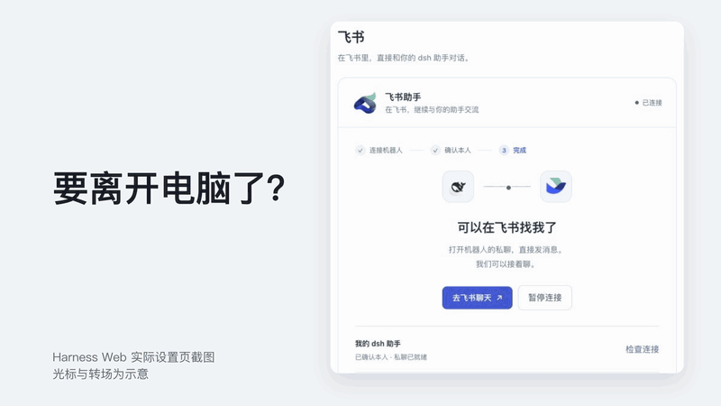

# dsh-lark-agent

[English](README.md)

[](https://www.npmjs.com/package/dsh-lark-agent)

**离开电脑，也能在飞书里找到你的 [DeepSeek Harness](https://www.deepseek.com/harness/) 助手。**

dsh-lark-agent 给运行中的 DeepSeek Harness 加一个飞书私聊入口：在手机上交代需求、讨论方案、继续之前的话题。飞书使用独立会话，不接管桌面或 Web 中已有的聊天。

[](assets/readme/intro.mp4)

## 安装 / 更新

开始前：

- DeepSeek Harness 正在运行、能正常对话并已选好默认模型：PC App `0.2.1-rc.2`，或 Web / `dsh` CLI `0.1.1-rc.2`。
- 在同一台机器上**先**装好官方 Lark CLI，再启用插件（需要 Node.js / npm）：

  ```sh
  npm install -g @larksuite/cli@1.0.98
  lark-cli --version
  ```

  不要执行 `lark-cli config init` 或 `lark-cli auth login`：扫码时插件会自建专用 profile，`config init` 可能覆盖已有配置。

### 在 DeepSeek Harness 桌面版中安装

在侧栏打开 **插件 → 添加插件**，填入 `dsh-lark-agent`，点「安装」，再点「立即启用」；需要时按提示重启。


### 使用 `dsh` CLI 安装

[`dsh plugin`](https://www.npmjs.com/package/@deepseek-ai/dsh) 会调用 pnpm，需先装好 pnpm 并确保它在 PATH 中：

```sh
dsh plugin --profile web add dsh-lark-agent --allow-build=protobufjs
```

然后重启 `dsh web`。

> [!NOTE]
> `--allow-build=protobufjs` 允许飞书 SDK 的依赖运行安装脚本；不加时 pnpm 11 会报 `ERR_PNPM_IGNORED_BUILDS`，dsh 不会启用插件。如果已经报了这个错，运行：
>
> ```sh
> dsh plugin --profile web approve-builds '!protobufjs'
> ```
>
> `!` 表示跳过这个只打印版本提示的可选脚本，之后 dsh 会完成插件启用，再重启 `dsh web`。

### 更新

1. 在飞书设置页点「暂停连接」，按[升级](DEVELOPMENT.md#升级)备份。
2. 桌面版：在插件页卸载 `dsh-lark-agent` 后重新添加（弹窗提示第三方插件需先卸载再安装新版；App 内升级尚未实机验证；更早从源码安装的版本显示为 `dsh-larkbot`）。CLI：运行 `dsh plugin --profile web update dsh-lark-agent@latest`，再重启 `dsh web`。
3. 点「恢复连接」，确认机器人能回复。

## 连接飞书

1. 打开飞书设置页（桌面版：**设置 → 内置插件 → 飞书**；Web：**设置 → 插件 → 飞书**），点「扫码创建并连接」。
2. 用自己的飞书账号扫码并授权。企业要求审批时，批准后点「重新检查」。
3. 点「打开飞书私聊」，用扫码的同一账号把配对词（`DSH-…`，10 分钟有效）以纯文本原样单独发给机器人；界面请你确认时点「这是我，完成连接」。
4. 设置页显示「已连接」后，给机器人发一条消息。

飞书入口依赖宿主在线：关闭 App、停止 Web 宿主或电脑休眠后无法使用。

## 能做什么

| 你在飞书里 | 助手会 |
| --- | --- |
| 发消息交代需求 | 像在电脑上一样用 Harness 的工具（联网搜索、读网页、读写工作区文件等）完成，回复实时显示在一张卡片里，思考过程和工具进度折叠在卡片中，点开可看 |
| 让它做需要确认的操作 | 发确认卡片，点「允许一次」或「拒绝」；5 分钟没确认就不执行 |
| 被 Harness 问到选择 | 发选项卡片，点一下或填完提交 |
| 「把结果文件发给我」 | 把工作区里的文件直接发到私聊 |
| 说「以后先给结论，再展开」 | 记住偏好 |
| 继续发，或用 `/sessions`、`/new` | 接着当前话题，或回到旧对话、开新话题 |
| 「用柱状图比较这些数据」 | 回一张飞书原生图表卡片 |
| 「先给我几个方案选一下」 | 发表单卡片，提交后接着聊 |
| 「把方案画成架构图」「整理成报告」 | 生成只授权你阅读的飞书文档（架构图附画板）；在 App `0.2.1-rc.2` 中打开这段飞书会话还能本地预览 |
| `/model`、`/thinking` | 切换宿主里已配置的模型和思考深度 |

默认只回应你本人的私聊。私聊里的助手就是电脑上的 Harness：能用哪些工具、哪些操作要确认，都由电脑上的权限设置决定。会话和记忆存在运行 Harness 的电脑上，消息经过飞书和模型服务商。

## 须知

- **更多文档**：命令、隐私、升级、底部菜单、团队部署与排障见[使用与开发文档](DEVELOPMENT.md)。
- **兼容性**：已在 PC App `0.2.1-rc.2` 与 `dsh` CLI / Web `0.1.1-rc.2` 上验证；其他版本、平台和企业租户尚未逐一验证。

## 许可证

[MIT](LICENSE)。DeepSeek、飞书 / Lark 品牌资产归其权利人所有，不适用 MIT 许可；本项目是独立的开源插件，非官方出品。
